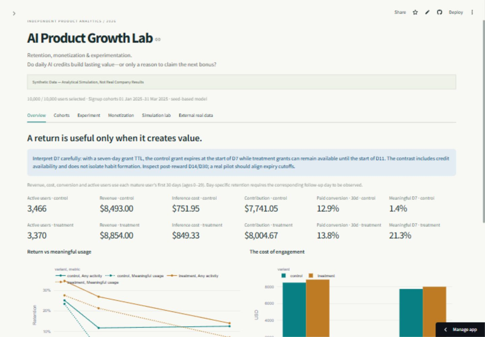

# AI Product Growth Lab

**Retention, Monetization & Experimentation**

Can daily token rewards improve meaningful retention and paid conversion without undermining AI product unit economics?

> **Synthetic Data — Analytical Simulation, Not Real Company Results**
>
> A product concern encountered in Monolit motivated the question. No preserved company analytics, real user records, measured experiment effect or verified implementation is claimed. This is a new independent portfolio project, implemented with AI engineering assistance. A separately licensed UCI e-commerce dataset provides an independent real-data study.

The lab compares **$5 upfront** with **$1 on each of five eligible user-age days**, using an auditable behavioral simulation rather than independent random CSVs. Inspect retention, distinguish reward-only sessions from meaningful use, challenge economic assumptions and review a proposed experiment before making a rollout recommendation.

## Run the product

Python 3.11–3.13. From this folder:

```bash
python -m venv .venv
# macOS/Linux: source .venv/bin/activate
# Windows PowerShell: .venv\Scripts\Activate.ps1
python -m pip install -r requirements-dev.txt
python -m scripts.pipeline --users 10000 --seed 42 --scenarios
python -m scripts.external
python -m streamlit run dashboard/app.py
```

Open http://localhost:8501. The supplied ZIP already contains seeded data, reports and SQL outputs. The dashboard generates the documented default when raw data is absent in a Git checkout. No API key, paid model or private data is required.

Serve the static case study with `python -m http.server 8000` and open http://localhost:8000/case-study/. `case-study/research.html` is an offline interactive Python research report, including cohort heatmaps, meaningful retention curves, daily activity, distributions, monetization and economic sensitivity. `case-study/external.html` is the separate real-data report. Open either directly or via the server.

**Published:** [Live dashboard](https://alyalbina-ai-growth-lab.streamlit.app/) · [GitHub source](https://github.com/alyalbina/ai-product-growth-lab) · [Product case study](https://alyalbina.github.io/ai-product-growth-lab/) · [Interactive research preview](https://alyalbina.github.io/ai-product-growth-lab/research.html) · [Independent real-data study](https://alyalbina.github.io/ai-product-growth-lab/external.html).

[Pull Request #1](https://github.com/alyalbina/ai-product-growth-lab/pull/1) was merged after [CI passed on Python 3.11–3.13](https://github.com/alyalbina/ai-product-growth-lab/actions/runs/38150789073). The [main-branch checks](https://github.com/alyalbina/ai-product-growth-lab/actions/runs/38150923989) also passed. The public site and both reports were checked in the browser. These static reports support hover, zoom and exports; they do not execute the Python simulation. The live Streamlit dashboard was verified on 11 October 2026: all six views, channel and empty-selection filters, a 1,000-user negative scenario with saving, and CSV export matching the release summary. See [publishing](docs/publishing.md) and [verification](docs/validation.md).



The [desktop case](docs/screenshots/case-study-desktop.jpg), [mobile case](docs/screenshots/case-study-mobile.jpg) and [scenario lab](docs/screenshots/dashboard-simulation-lab.jpg) screenshots are actual browser captures.

## What is implemented

| Area | Reviewable evidence |
| --- | --- |
| Data engineering | Fixed-seed daily model, eight linked tables, explicit credit expiry/consumption ledger, subscription payments and reconciliation |
| SQL analytics | Executable SQLite queries with CTEs, windows, cohort dates, inactive-user denominators and null-safe ratios |
| Python analysis | EDA, cohort retention, calendar engagement, distributions, segment economics, three-seed parameter sensitivity |
| Experimentation | User-level ITT, mature windows, primary risk-difference CI, SRM, Holm-adjusted secondary tests, economic guardrails, power planning and A/A calibration |
| Interactive product | Six dashboard views, cohort/channel/segment filters, chart interactions, exports and bounded scenario recomputation |
| Product case study | Eleven sections connecting behavioral hypotheses to measurement, economics and decision rules |
| Real data | Independent reproducible analysis of 12,330 UCI sessions under CC BY 4.0, with provenance, limitations and data-quality reporting |
| Engineering QA | pytest, Ruff, SQL/Python parity checks, Streamlit AppTest and CI across Python 3.11–3.13 |

## Measurement choices that matter

- **Finite baseline entitlement:** five $1 grants versus one $5 grant. Grants occur automatically at eligible account ages, whether the user visits or not. Paid users no longer receive promotional grants. Actual issued and redeemed totals may differ; compare them rather than assuming equal cost.
- **Value before activity:** meaningful retention requires at least two successful AI requests on the specified day. A session without successful use is a low-value proxy, not a verified fraud or reward-hunting label.
- **Administrative censoring:** enrollment spans 90 calendar days. Late accounts are excluded only from windows they cannot yet complete, not because they fail to return.
- **Comparable economics:** experiment and executive cash/cost metrics use the first 30 days of mature accounts. Cash contribution excludes CAC, overhead, tax and payment fees. Inference rates are hypothetical model parameters, not current vendor price quotations.
- **Honest uncertainty:** confidence intervals describe sampling variation under the chosen model. Behavioral misspecification is investigated through scenarios and parameter sensitivity, not covered by a p-value.
- **Independent evidence:** the UCI `Revenue` label means purchase, not dollars. Its sessions cannot estimate person-level retention or an AI-token treatment effect.

## Reproduce the analysis

```bash
python -m scripts.pipeline --users 10000 --seed 42 --scenarios
python -m scripts.sensitivity --users 1000 --seeds 42 43 44
python -m scripts.calibrate
python -m scripts.external
python -m scripts.research
python -m scripts.external_report
python -m scripts.results_document
python -m pytest -q
python -m ruff check .
```

The pipeline validates tables, writes deterministic compressed CSVs and a configuration/hash manifest, builds SQLite, executes every SQL query and saves experiment/scenario reports. The raw generated dataset is ignored in Git and included in the handoff ZIP. Small release reports and external data are tracked. The full local package resolution is recorded in `requirements-lock.txt`.

## Explore the repository

```text
src/simulation/        Daily behavior, credit ledger, configurable scenarios
src/validation/        Identity, observation and financial reconciliation
src/analytics/         User-weighted metrics, EDA and SQLite export
src/experimentation/   Inference, power and null calibration
sql/                   Retention, engagement, funnels, monetization, economics
dashboard/             Streamlit product
case-study/            Public-ready static narrative and offline research
scripts/               Reproduction commands
data/synthetic/        Generated release, scenarios, SQL and sensitivity outputs
data/external/         Licensed UCI source and independent analysis
docs/                  Assumptions, metric contract, experiment and career materials
tests/                 Reconciliation, statistical and interface checks
.github/workflows/     Analytics verification and Pages deployment
```

## Documentation

[Setup](docs/setup.md) · [Data dictionary](docs/data-dictionary.md) · [Metric definitions](docs/metric-definitions.md) · [Simulation assumptions](docs/simulation-assumptions.md) · [Experiment design](docs/experiment-design.md) · [Architecture](docs/architecture.md) · [Results & limitations](docs/results-limitations.md) · [Verification](docs/validation.md) · [Demo walkthrough](docs/demo-guide.md) · [CV, LinkedIn & interviews](docs/portfolio.md) · [Publishing](docs/publishing.md).

This project complements [Hotel Guest Experience Platform](https://github.com/alyalbina/hotel-guest-experience-platform), which focuses on UX research, business requirements, service design and MVP workflows. This second project focuses on analytical depth and defensible product decisions.

**Author:** Albina Urubkina. Code: MIT. UCI data: CC BY 4.0 with original creator attribution in `data/external/README.md`.
