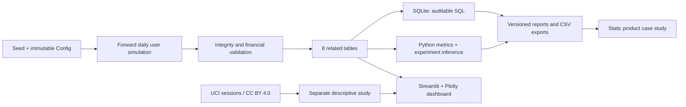

# Architecture and decisions

The first portfolio project, [Hotel Guest Experience Platform](https://github.com/alyalbina/hotel-guest-experience-platform), traces UX research through business requirements, service workflows and a working hospitality prototype. This project adds a distinct analytical skill set: behavioral simulation, relational analysis, censoring, statistical inference and monetization decisions.

**One language and a small deployment surface.** Streamlit is appropriate for a portfolio analytical product with bounded CPU work. Plotly provides hover, zoom and chart export. SQLite makes all SQL executable without a paid warehouse. There is no authentication, operational database, API key, LLM call or background data collection.

**Cash and credit are different ledgers.** Subscription records describe a contract; payments record actual charges. Promotional retail credit is not cash revenue and not provider cost. AI request input/output tokens determine estimated provider cost. Contribution equals cash receipts minus modeled inference cost; it omits CAC, overhead, payment fees, tax and salaries. Cash-based contribution is not GAAP recognized revenue or comprehensive profit.

**Calendar horizon and user age are different clocks.** Signup occurs throughout 90 calendar days, creating incomplete late cohorts. Retention uses eligible user-age windows. Monetary experiment comparisons and executive totals use a common first 30 days among mature accounts; calendar activity describes the actual observed period. Filters select signup cohorts, never surviving active users.

**Independent public evidence.** Real e-commerce sessions are loaded through a separate module and never join the synthetic tables. No cross-domain validation claim is made.

**Release boundary.** Raw generated CSVs and the SQLite database are reproducible build artifacts, ignored in Git. The delivered ZIP includes a seeded data release for fast local inspection. Small report JSON, SQL results, charts and external CSV are tracked. The deployed dashboard can generate its default release when files are absent; caches are bounded. Simulation Lab has a user cap and an explicit submit action. Do not use it as an unbounded public compute service.
